# Results

Both models were run on the same 0.5 m surface models and the same weather file for Hobart Ellerslie Road, so any difference between them comes from the models and not the data. Use the tabs to step through the results for each subset. The maps are all the same size and extent, so they line up when switching tabs.

The results are set out in the same order as the project objectives: yearly sunlight from our model (Objective 1), SEBE (Objective 2), the comparison between them (Objective 3) and suitable roof area (Objective 4).

## Sandy Bay

::::{tab-set}
:::{tab-item} Yearly Sunlight
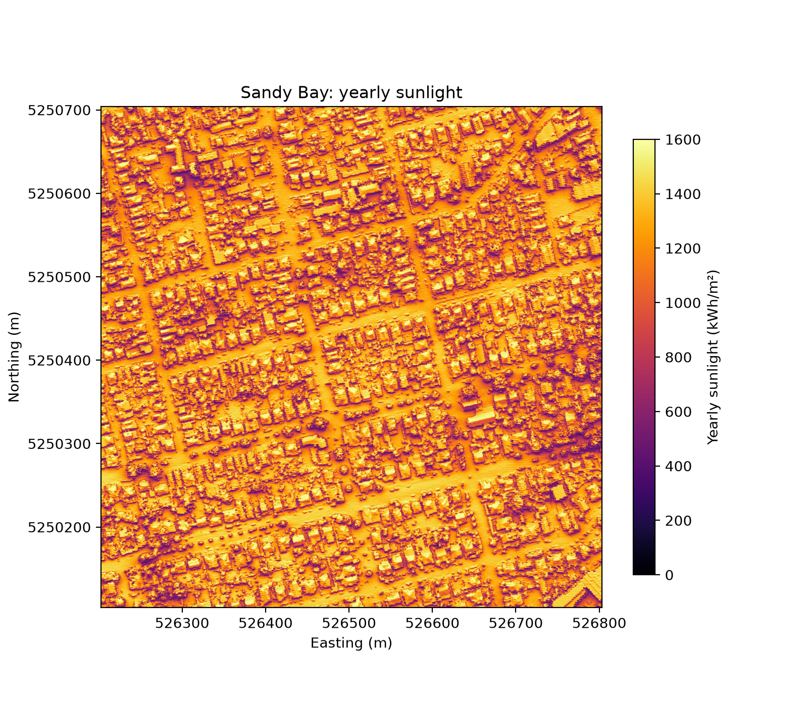

Yearly sunlight across the Sandy Bay subset ranged from about 384 to 1,597 kWh/m², almost the same range as Howrah. Roads and other flat open areas again received the most. Unlike Howrah, Sandy Bay has no large area of bush, but trees are spread through backyards and along streets, so there are small shaded patches across the whole subset. North-facing roof faces are again the brightest surfaces.

:::
:::{tab-item} Roofs: Python model
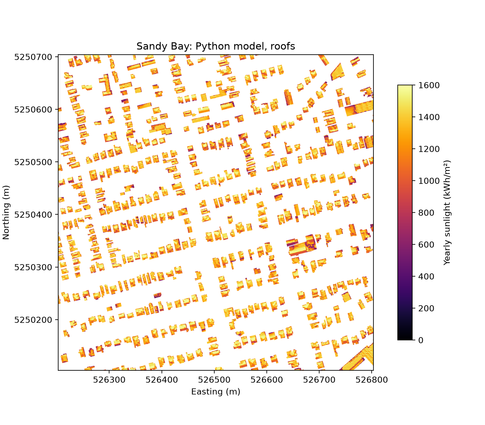

Most roofs in Sandy Bay receive between 1,200 and 1,500 kWh/m² a year, similar to Howrah. Because the houses are smaller and closer together, more of each roof is affected by roof edges, south-facing faces and shading from neighbouring buildings and trees. The lower values are spread across many buildings rather than being grouped in one area like they are in Howrah. A few roofs show a striped pattern, which is likely to come from corrugated roofing or small errors in the surface model.

:::
:::{tab-item} Roofs: SEBE
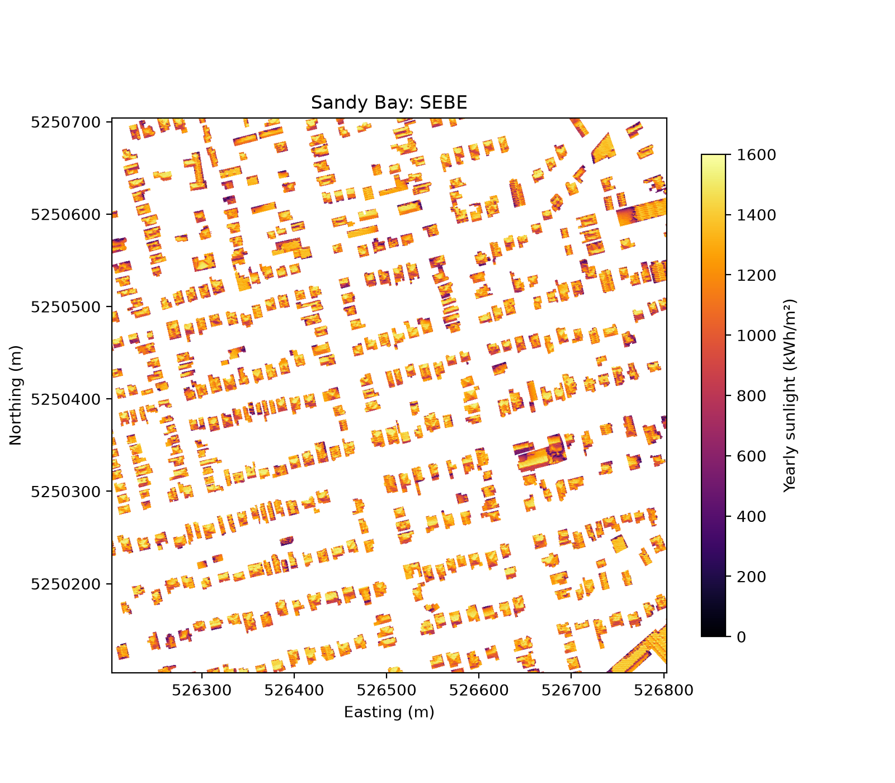

SEBE shows the same pattern as our model for Sandy Bay, with bright north-facing faces and darker south-facing faces and roof edges. The values are slightly lower across the subset, but the difference is hard to see side by side, so it is shown directly in the next tab.

:::
:::{tab-item} Difference
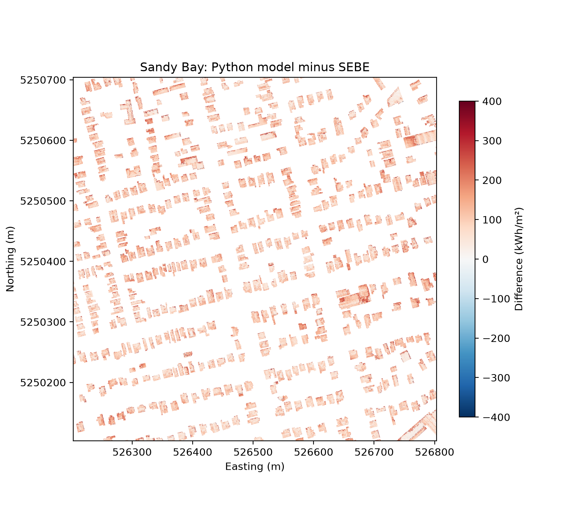

Our model was again higher than SEBE on almost every roof cell, with an average difference of about [ ] kWh/m² ([ ]%). The difference is more even across Sandy Bay than in Howrah, with most roofs between 100 and 150 kWh/m² higher. The smallest differences were on large, open roofs, which have little shading, so the two models handle them in a similar way. The largest differences were on small buildings tightly packed between others. This supports what we saw in Howrah: the more a roof is shaded, the bigger the gap, because SEBE shades diffuse sunlight and our model doesn’t. Since Sandy Bay is more tightly built, more of its roofs are partly shaded, which is likely why the difference is more spread out here.

:::
:::{tab-item} Suitable roof
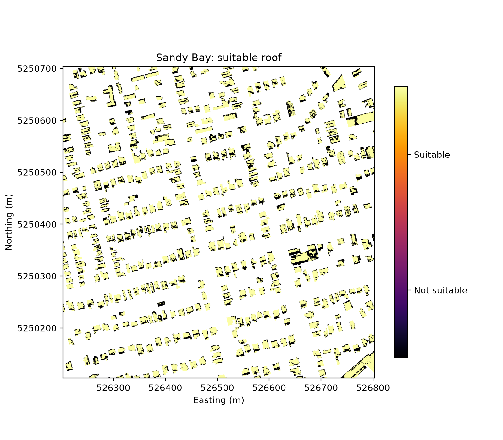

Most roof area in Sandy Bay passed all three rules, with [ ] m² of suitable roof out of [ ] m² in total ([ ]%). The roof area that failed is spread across the subset in small patches, mostly on south-facing faces, roof edges and parts of roofs shaded by trees or neighbouring houses. Large flat roofs were almost entirely suitable. As with Howrah, these results come from our model, so the suitable area is probably a slight overestimate, especially on the small, tightly packed roofs where our model differs most from SEBE.

:::
:::::

Sandy Bay has dense housing, and roofs cover 21% of the subset. North-facing roof faces stand out clearly in both models, and the difference map is pale across most roofs, which means the two models mostly agree. The biggest differences are on roof faces shaded by trees and neighbouring buildings.


## Howrah

::::{tab-set}
:::{tab-item} Yearly Sunlight
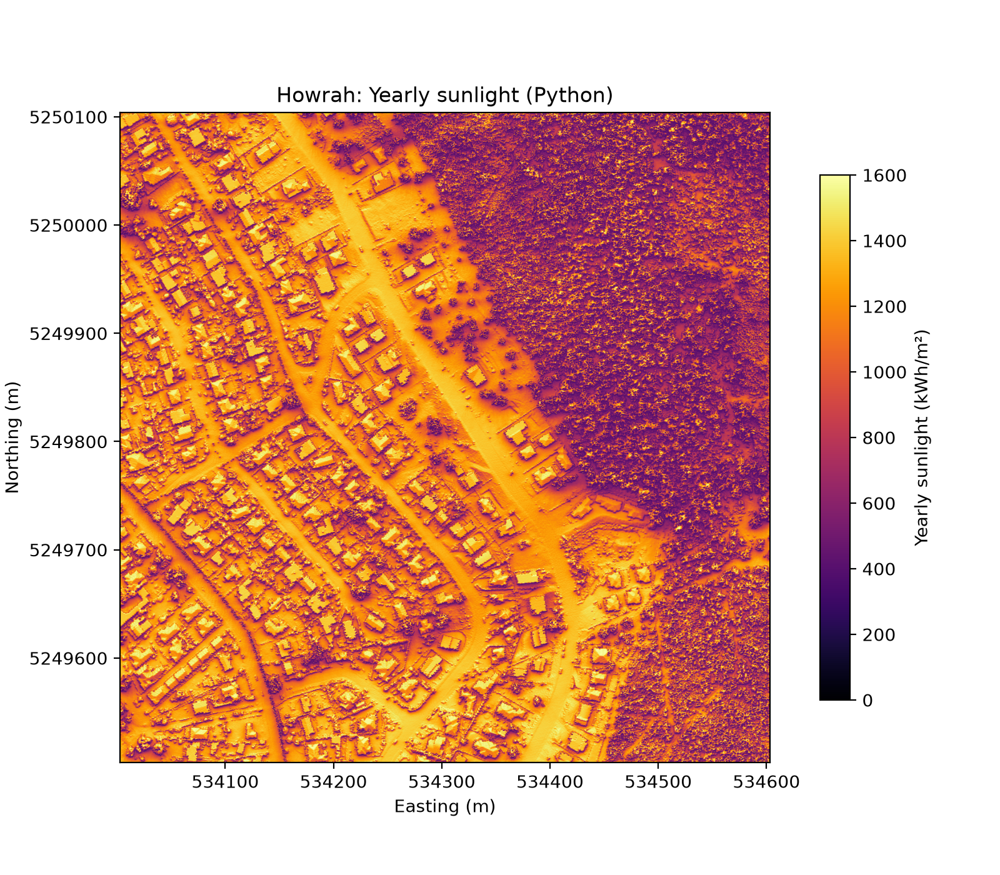

Yearly sunlight across the Howrah subset ranged from about 385 to 1,596 kWh/m². Flat open areas like roads received the most, at close to the 1,424 kWh/m² measured on flat ground in the weather file. Within the suburb, north-facing roof faces stand out as the brightest surfaces, while south-facing faces and areas behind trees receive noticeably less. The bushland in the east of the subset is much darker, because the surface model treats the canopy as a rough surface that shades itself.

:::
:::{tab-item} Roofs: Python model
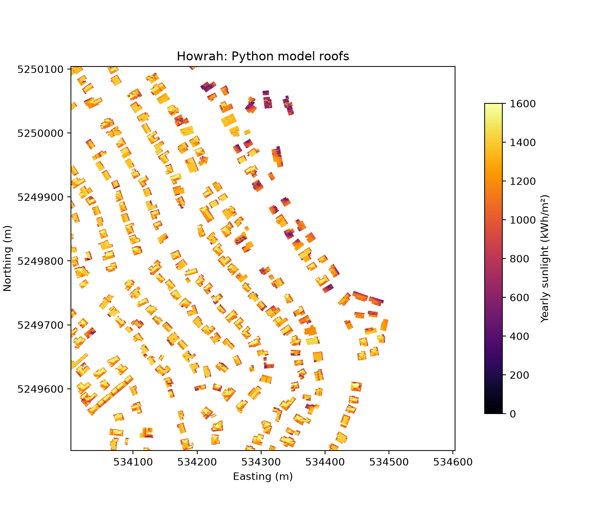

Once only the roofs are kept, most of Howrah receives between 1,200 and 1,500 kWh/m² a year. Roof direction makes the biggest difference within each building, with north-facing faces receiving more than south-facing ones. The lowest values are on buildings along the edge of the bushland in the north-east, where trees shade the roofs for much of the day.

:::
:::{tab-item} Roofs: SEBE
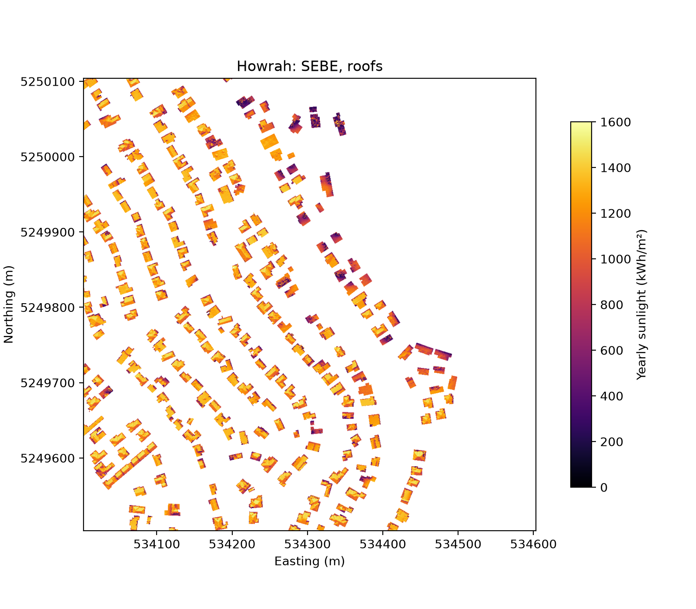

SEBE shows the same overall pattern as our model, with north-facing roof faces receiving the most and roofs near the bushland receiving the least. The SEBE roofs are slightly darker across the whole subset, though, which shows that SEBE estimates less yearly sunlight than our model. The difference is hard to see by eye, so it is mapped directly in the next tab.

:::
:::{tab-item} Difference
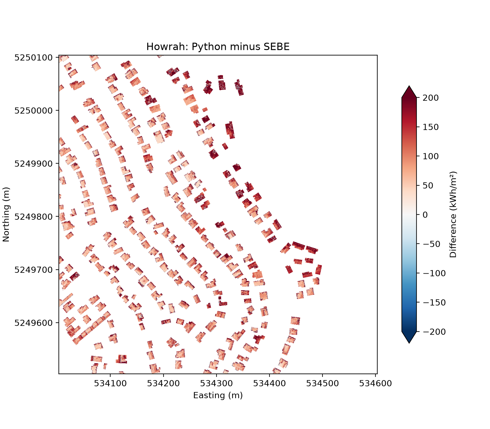

Our model gave higher values than SEBE on almost every roof cell in Howrah, with an average difference of about [ ] kWh/m² ([ ]%). Most roofs were between 50 and 150 kWh/m² higher. The biggest differences were on the shaded roofs along the bushland edge and on small buildings next to larger ones. This fits with the main difference between the two models: SEBE shades diffuse sunlight from the sky as well as direct sunlight, while our model only shades direct sunlight. So the more shading a roof has, the more our model overestimates it.

:::
:::{tab-item} Suitable roof
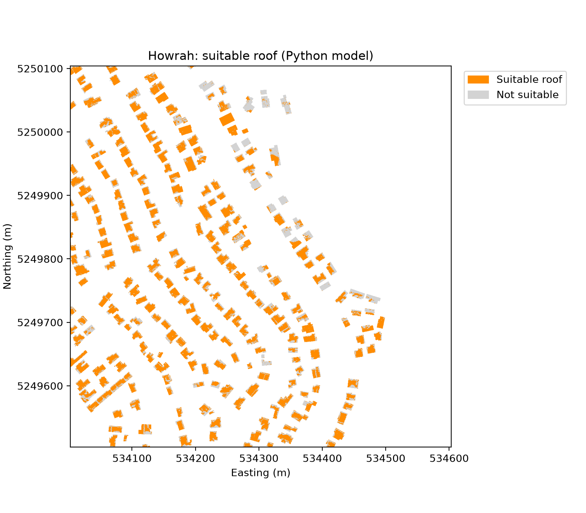

Most of the roof area in Howrah passed all three rules, with [ ] m² of suitable roof out of [ ] m² in total ([ ]%). The roof area that failed was mostly on south-facing roof faces, which didn’t get enough sun, and on buildings next to the bushland, where trees shade most of the roof. Thin strips along roof edges were also removed by the slope rule. Since these results come from our model, which was higher than SEBE, the suitable area is probably a slight overestimate, especially for the shaded buildings near the bush.

:::
::::

Howrah has fewer buildings, with roofs covering 13% of the subset, and bushland along its eastern side. That bushland is the main reason sunlight is lower overall in Howrah, and the roofs along its edge are the most shaded in the subset. These shaded edge roofs are also where our model is furthest above SEBE.


## Yearly sunlight from the Python model

Across each full subset, yearly sunlight ranged from under 400 kWh/m² on cells that never get direct sun to about 1,600 kWh/m² on the best-placed surfaces. For scale, unshaded flat ground gets 1,424 kWh/m² in our weather file. The highest values were on roof faces angled towards the north, and the lowest were on south-facing faces and on cells shaded by trees or neighbouring buildings. The middle value was higher in Sandy Bay than in Howrah, mostly because of the bushland on the eastern side of the Howrah subset.

| | Lowest | Middle | Highest |
|---|---|---|---|
| Sandy Bay | 384 | 1,181 | 1,597 |
| Howrah | 385 | 1,038 | 1,596 |

Values are in kWh/m² per year, for every cell in the subset.

## Sunlight on roofs

Roofs cover 21% of the Sandy Bay subset and 13% of the Howrah subset. Most roofs received between about 1,200 and 1,500 kWh/m², with each roof showing a brighter north-facing side and a darker south-facing side. The poorest roofs in Howrah sit along the edge of the bushland, where the trees shade them for much of the day.

| | Lowest | Highest |
|---|---|---|
| Sandy Bay: Python model | 397 | 1,597 |
| Sandy Bay: SEBE | 213 | 1,614 |
| Howrah: Python model | 388 | 1,594 |
| Howrah: SEBE | 213 | 1,586 |

Values are in kWh/m² per year, for roof cells only.

## Comparison with SEBE

### Cell by cell

The two models reach almost the same highest values, but SEBE goes much lower on the most shaded roof cells. Our model was higher than SEBE on almost every roof cell. For 95% of roof cells, our model was between 0 and about 230 kWh/m² higher in Sandy Bay, and between about −6 and 260 kWh/m² higher in Howrah. On the difference maps, pale yellow shows where the models nearly agree and dark red shows where our model is well above SEBE.

### Roof by roof

To compare whole roofs, the average yearly sunlight on each building was found for both models using zonal statistics in QGIS ([](#fig-model-graphs)).

```{figure} Images/SEBE_vs_Python_graphs.png
:label: fig-model-graphs
:width: 100%
:alt: Graphs comparing the Python model and SEBE for each building

Comparison of our Python model and SEBE for each building, using zonal statistics.
```

| | Sandy Bay | Howrah |
|---|---|---|
| Number of roofs | [484] | [257] |
| SEBE mean (kWh/m²) | 1,334 | 1,253 |
| Python model mean (kWh/m²) | 1,459 | 1,377 |
| Average difference, Python minus SEBE (kWh/m²) | +125 | +123 |
| Average difference as % of SEBE | 9.3% | 9.8% |
| RMSE (kWh/m²) | 131 | 129 |
| Correlation (R²) | 0.91 | 0.96 |
| Roofs where Python model is higher | all | all |

Our model was higher than SEBE on every roof, by about 125 kWh/m², or around 9 to 10%, on average in both subsets. The two models were still very closely related. The R² values of 0.91 in Sandy Bay and 0.96 in Howrah mean most of the variation between roofs in SEBE is matched by our model. The Spearman values of 0.95 and 0.94 show the two models ranked the roofs in almost the same order, so the roofs that come out best in one model also come out best in the other.

The regression slopes of 0.87 and 0.84 show that the gap is not the same for every roof. It is largest on roofs that get less sun and smallest on the sunniest roofs. For a roof that gets 1,000 kWh/m² in SEBE, our model gives about 170 kWh/m² more, but for a roof that gets 1,500 kWh/m² the gap drops to about 85 to 105 kWh/m². This fits with our model not shading diffuse sunlight, which matters most on roofs that are already shaded.

:::{dropdown} Full comparison statistics
| Metric | Sandy Bay | Howrah |
|:--|--:|--:|
| SEBE median | 1,351.0 | 1,307.5 |
| Python median | 1,470.2 | 1,414.3 |
| MAE | 124.7 | 123.4 |
| NRMSE (% of SEBE mean) | 9.8% | 10.3% |
| Median % difference | 8.7% | 8.7% |
| Pearson r | 0.956 | 0.981 |
| Regression slope | 0.872 | 0.835 |
| Regression intercept | 295.8 | 330.5 |
| Spearman ρ | 0.949 | 0.943 |
| Wilcoxon p-value | 7.5e-97 | 1.7e-47 |

Positive values mean our model is higher than SEBE.
:::

### Total sunlight per roof

Adding up the sunlight on each building gives one total per roof. These totals depend on the size of the roof as well as how sunny it is, so the few large buildings fall in the highest class and most houses sit in the middle classes. The two models gave a very similar pattern, with SEBE slightly lower. [The largest roof in Sandy Bay reached about 1.78 million kWh a year in SEBE and 1.89 million in our model. In Howrah it was about 1.10 million in SEBE and 1.19 million in ours.]

::::{tab-set}
:::{tab-item} Python model

:::
:::{tab-item} SEBE
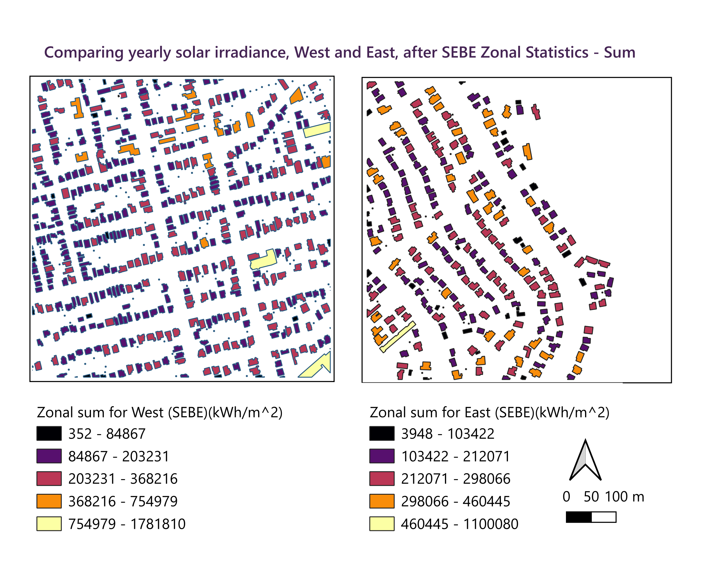
:::
::::

Values are the total yearly sunlight on each building in kWh per year, shown in five natural breaks classes.

:::::{tab-set}
:::{tab-item} Python model
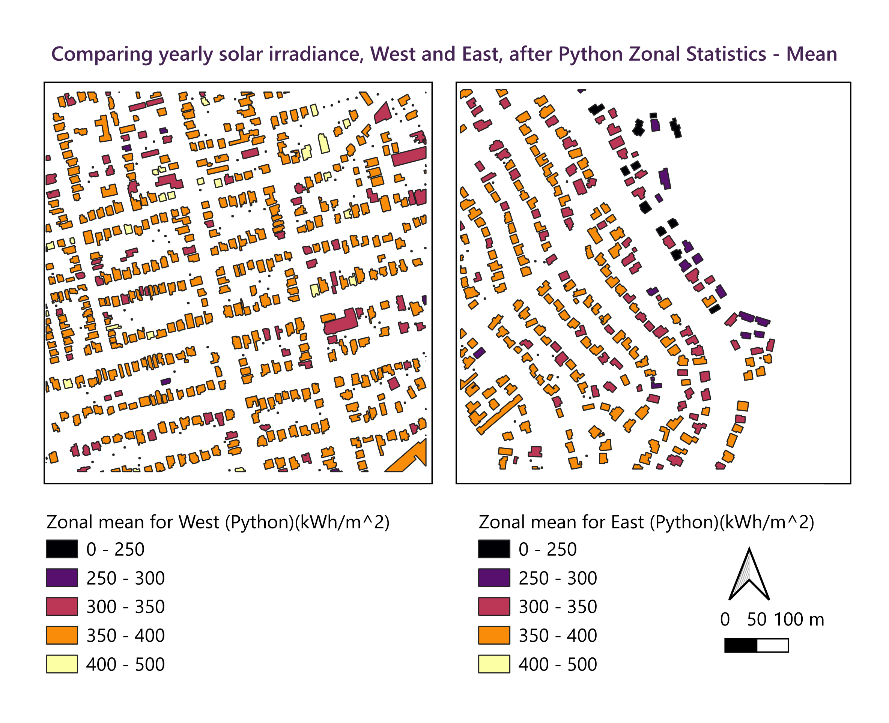
:::
:::{tab-item} SEBE
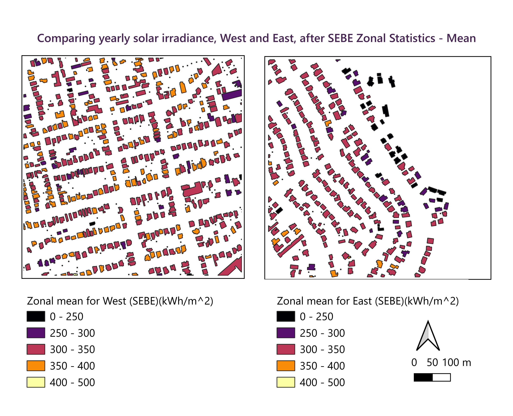
:::
::::

Values are the mean yearly sunlight on each building in kWh/m², shown in five user-defined intervals.


## Suitable roof area

A roof cell was counted as suitable if it is on a building, has a slope of 65° or less, and gets at least 80% of the sunlight on unshaded flat ground (1,139 kWh/m²). The criteria were applied to the Python model results.

| | Sandy Bay | Howrah |
|---|---|---|
| Roof area (m²) | 76,412 | 45,217 |
| Suitable area (m²) | 53,279 | 30,504 |
| Share suitable | 70% | 67% |

About two thirds of the roof area was suitable in both subsets. The parts that failed were mostly south-facing roof faces, roof edges and shaded areas.

## Key results

- **Objective 1:** Yearly sunlight on roofs from our model ranged from about 400 to 1,600 kWh/m², with north-facing, unshaded roof faces getting the most.
- **Objectives 2 and 3:** Our model was higher than SEBE on every roof, by about 125 kWh/m² (9 to 10%) on average. The gap was largest on shaded roofs and smallest on the sunniest ones.
- **Objective 3:** The two models were closely related (R² of 0.91 and 0.96) and ranked the roofs in almost the same order (Spearman ρ of 0.95 and 0.94).
- **Objective 4:** About two thirds of the roof area in both subsets was suitable for solar panels.


## SORT OUT

| | Sandy Bay | Howrah |
|---|---|---|
| Buildings | 484 | 257 |
| Main source of shading | Neighbouring houses and backyard trees | Bushland on the north-east edge |
| Mean roof sunlight, Python (kWh/m²) | 1,252 | 1,219 |
| Mean roof sunlight, SEBE (kWh/m²) | 1,151 | 1,114 |
| Mean difference (kWh/m²) | 100 (8.7%) | 105 (9.5%) |
| R² between models (roof by roof) | [ ] | [ ] |
| Total roof area (m²) | 76,412 | 45,217 |
| Suitable roof area (m²) | 53,279 (70%) | 30,504 (67%) |