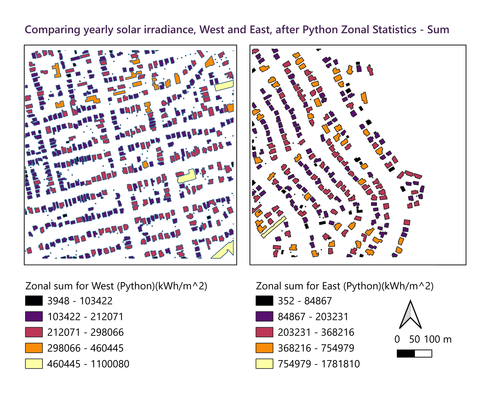

# Results

Both models were run on the same 0.5 m surface models and the same weather file for Hobart Ellerslie Road, so any difference between them comes from the models and not the data. Use the tabs to step through the results for each subset. The maps are all the same size and extent, so they line up when switching tabs.

## Sandy Bay

::::{tab-set}
:::{tab-item} Yearly Sunlight

:::
:::{tab-item} Roofs: Python model

:::
:::{tab-item} Roofs: SEBE

:::
:::{tab-item} Difference

:::
:::{tab-item} Suitable roof

:::
::::

* Analysis here

## Howrah

::::{tab-set}
:::{tab-item} Yearly Sunlight

:::
:::{tab-item} Roofs: Python model

:::
:::{tab-item} Roofs: SEBE

:::
:::{tab-item} Difference

:::
:::{tab-item} Suitable roof

:::
::::

* Analysis Here 

## Yearly sunlight from the Python model

Across each full subset, yearly sunlight ranged from under 400 kWh/m² on cells that never get direct sun to about 1,600 kWh/m² on the best-placed surfaces. For scale, unshaded flat ground gets 1,424 kWh/m² in our weather file. The highest values were on roof faces angled towards the north, and the lowest were on south-facing faces and on cells shaded by trees or neighbouring buildings. The middle value was higher in Sandy Bay than in Howrah, mostly because of the bushland on the eastern side of the Howrah subset.

| | Lowest | Middle | Highest |
|---|---|---|---|
| Sandy Bay | 384 | 1,181 | 1,597 |
| Howrah | 385 | 1,038 | 1,596 |

Values are in kWh/m² per year, for every cell in the subset.

## Sunlight on roofs

Roofs cover 21% of the Sandy Bay subset and 13% of the Howrah subset. Most roofs received between about 1,200 and 1,500 kWh/m², with each roof showing a brighter north-facing side and a darker south-facing side. The poorest roofs in Howrah sit along the edge of the bushland, where the trees shade them for much of the day.

| | Lowest | Highest |
|---|---|---|
| Sandy Bay: Python model | 397 | 1,597 |
| Sandy Bay: SEBE | 213 | 1,614 |
| Howrah: Python model | 388 | 1,594 |
| Howrah: SEBE | 213 | 1,586 |

Values are in kWh/m² per year, for roof cells only.

## Comparison with SEBE

### Cell by cell

The two models reach almost the same highest values, but SEBE goes much lower on the most shaded roof cells. Our model was higher than SEBE on almost every roof cell. For 95% of roof cells, our model was between 0 and about 230 kWh/m² higher in Sandy Bay, and between about −6 and 260 kWh/m² higher in Howrah. On the difference maps, pale yellow shows where the models nearly agree and dark red shows where our model is well above SEBE.

### Roof by roof

To compare whole roofs, the average yearly sunlight on each building was found for both models using zonal statistics in QGIS ([](#fig-model-graphs)).

```{figure} Images/SEBE_vs_Python_graphs.png
:label: fig-model-graphs
:width: 100%
:alt: Graphs comparing the Python model and SEBE for each building

Comparison of our Python model and SEBE for each building, using zonal statistics.
```

| | Sandy Bay | Howrah |
|---|---|---|
| Number of roofs | [484] | [257] |
| SEBE mean (kWh/m²) | 1,334 | 1,253 |
| Python model mean (kWh/m²) | 1,459 | 1,377 |
| Average difference, Python minus SEBE (kWh/m²) | +125 | +123 |
| Average difference as % of SEBE | 9.3% | 9.8% |
| RMSE (kWh/m²) | 131 | 129 |
| Correlation (R²) | 0.91 | 0.96 |
| Roofs where Python model is higher | all | all |

Our model was higher than SEBE on every roof, by about 125 kWh/m², or around 9 to 10%, on average in both subsets. Even so, the two models ranked the roofs in almost the same order (R² of 0.91 in Sandy Bay and 0.96 in Howrah), so the roofs that come out best in one model also come out best in the other.

:::{dropdown} Full comparison statistics
| Metric | Sandy Bay | Howrah |
|:--|--:|--:|
| SEBE median | 1,351.0 | 1,307.5 |
| Python median | 1,470.2 | 1,414.3 |
| MAE | 124.7 | 123.4 |
| NRMSE (% of SEBE mean) | 9.8% | 10.3% |
| Median % difference | 8.7% | 8.7% |
| Pearson r | 0.956 | 0.981 |
| Regression slope | 0.872 | 0.835 |
| Regression intercept | 295.8 | 330.5 |
| Spearman ρ | 0.949 | 0.943 |
| Wilcoxon p-value | 7.5e-97 | 1.7e-47 |

Positive values mean our model is higher than SEBE.
:::

### Total sunlight per roof

Adding up the sunlight on each building gives one total per roof. These totals depend on the size of the roof as well as how sunny it is, so the few large buildings fall in the highest class and most houses sit in the middle classes. The two models gave a very similar pattern, with SEBE slightly lower. [The largest roof in Sandy Bay reached about 1.78 million kWh a year in SEBE and 1.89 million in our model. In Howrah it was about 1.10 million in SEBE and 1.19 million in ours.]

::::{tab-set}
:::{tab-item} Python model

:::
:::{tab-item} SEBE

:::
::::
Values are the total yearly sunlight on each building in kWh per year, shown in five natural breaks classes.

::::{tab-set}
:::{tab-item} Python model

:::
:::{tab-item} SEBE

:::
::::

Values are the mean yearly sunlight on each building in kWh/m², shown in five user-defined intervals.


## Suitable roof area

A roof cell was counted as suitable if it is on a building, has a slope of 65° or less, and gets at least 80% of the sunlight on unshaded flat ground (1,139 kWh/m²). The criteria were applied to the Python model results.

| | Sandy Bay | Howrah |
|---|---|---|
| Roof area (m²) | 76,412 | 45,217 |
| Suitable area (m²) | 53,279 | 30,504 |
| Share suitable | 70% | 67% |

About two thirds of the roof area was suitable in both subsets. The parts that failed were mostly south-facing roof faces, roof edges and shaded areas.

## Key results

- Yearly sunlight on roofs ranged from about 400 to 1,600 kWh/m², with north-facing, unshaded roof faces getting the most.
- Our model was higher than SEBE on every roof, by about 125 kWh/m² (9 to 10%) on average, with the biggest differences on the most shaded cells.
- The two models ranked the roofs in almost the same order (R² of 0.91 and 0.96).
- About two thirds of the roof area in both subsets was suitable for solar panels.